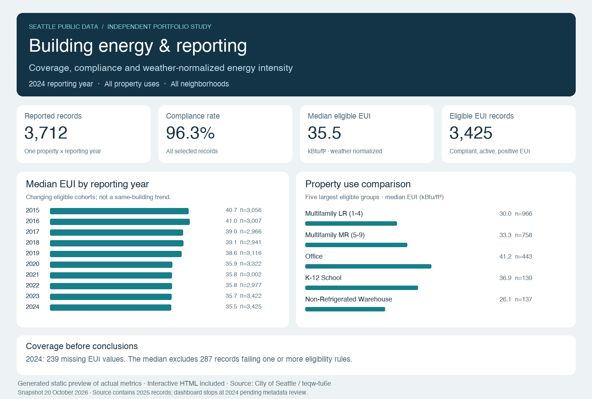
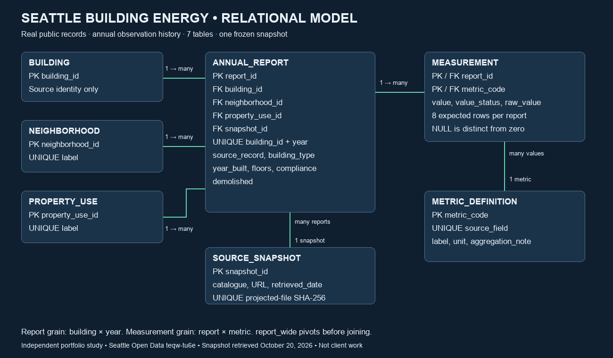
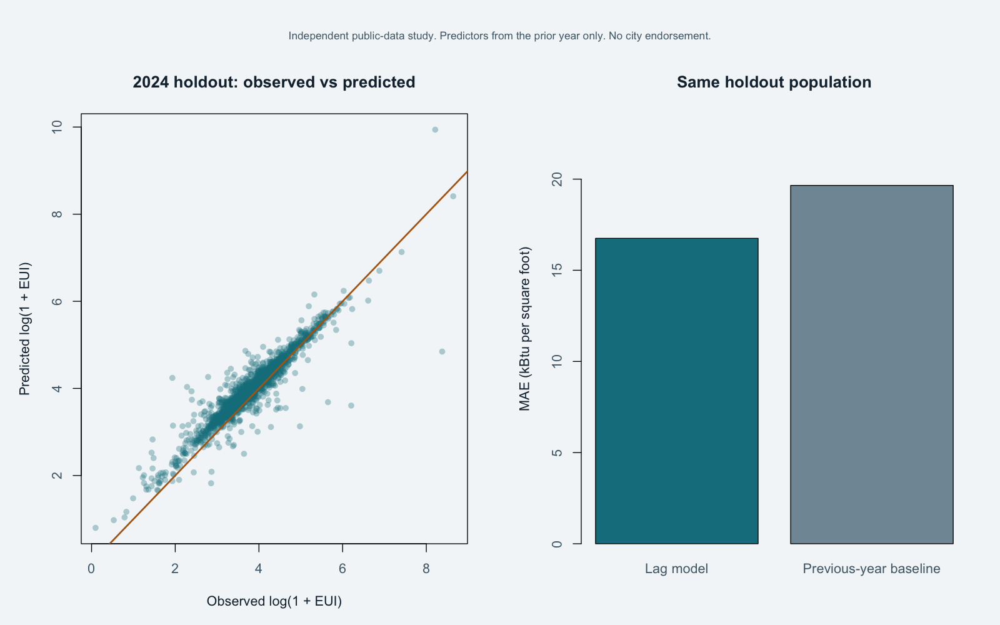

# Data science, analytics, governance & modeling portfolio

Independent portfolio by **Gian-Luca Matsuda**. Seven projects demonstrating data science, data research, data governance and data modeling using SQL, Python, R/RStudio and Excel.

**These are sample projects, not paid client engagements.** The first three use clearly labeled synthetic data. The Seattle studies use public records and are not affiliated with the City of Seattle. Code and documentation were developed with AI assistance and locally executed/validated; each project documents its methods and limitations.

## Browse the projects

| Project | Data | What it demonstrates |
| --- | --- | --- |
| [Retail SQL analytics](projects/sql-retail-analytics/) | Synthetic retail orders | SQL joins, window functions, revenue controls |
| [Governance operations dashboard](projects/governance-operations-dashboard/) | Synthetic governance requests | Excel, SLA definitions, Power BI/Tableau build kits |
| [Metadata export automation](projects/python-metadata-automation/) | Synthetic metadata exports | Python, validation, conflict quarantine, lineage |
| [Seattle energy analytics platform](projects/seattle-energy-data-platform/) | Seattle public building reports | Star schema, governance, SQL, offline dashboard |
| [Seattle energy modeling in R](projects/rstudio-building-energy-model/) | Seattle public building reports | Temporal regression, baseline comparison, model card |
| [Fremont mobility research in R](projects/rstudio-fremont-mobility/) | Seattle public counter records | Coverage-aware modeling, SQL mart, count regression |
| [Seattle relational energy model](projects/seattle-energy-relational-model/) | Seattle public building reports | Conceptual/logical/physical modeling, provenance, SQL constraints |

## Recommended starting points

- **Data modeling:** compare the Seattle star schema with the seven-table relational model. Both deliberately reuse the same public snapshot; they are different modeling approaches, not independent datasets.
- **Data science and research:** inspect the R studies’ model cards, temporal splits, baseline comparisons and actual holdout diagnostics. Reported weaknesses are preserved.
- **Governance and automation:** review metadata validation, exception handling, metric definitions, dictionaries and source hashes.
- **Business reporting:** open the Excel workbook or download and open the Seattle offline HTML dashboard.

## Run a project

Download or clone this repository, open a project folder, and follow its README. Run commands from that project directory. Python projects use Python 3.10+; the RStudio projects use base R and include `.Rproj` files. Node.js is optional for the Seattle dashboard logic check. No account credentials or production systems are required.

Generated SQLite databases are intentionally excluded from version control and are recreated by the documented build commands. Frozen input CSVs, diagrams, workbook, example outputs and reports are included. HTML dashboards/reports should be downloaded and opened locally; GitHub's file view displays source.

**Power BI and Tableau:** the governance dashboard includes Power Query/DAX/calculated fields and build guides. Native `.pbix` and `.twbx` files are not included, and static previews are not claimed as screenshots from those tools.

## Featured outputs

### Seattle energy analytics platform

[Explore the project](projects/seattle-energy-data-platform/)

### Seattle relational energy model

[Explore the project](projects/seattle-energy-relational-model/)

### Seattle energy modeling in R

[Explore the project](projects/rstudio-building-energy-model/)

## Data, licensing and limitations

Code is licensed under MIT; project-specific `LICENSE` files are retained. Seattle data attribution, snapshot dates and source hashes are documented in the relevant project READMEs and `DATA-LICENSE.txt` files. The public data uses its source’s Public Domain designation; the code license does not replace source-data notices. Synthetic input records are fictional. No employer, patient, customer or private client data is included.

Source records can be incomplete or revised. Missing data is not silently treated as zero. Research outputs are demonstrations with stated validation limits, not operational recommendations or guaranteed business outcomes.

## Professional profiles

[Upwork](https://www.upwork.com/freelancers/~01d90296eaffed4add) · [Contra](https://contra.com/gian_luca_matsuda_itzo120j) · [Fiverr](https://www.fiverr.com/glmatsuda)
