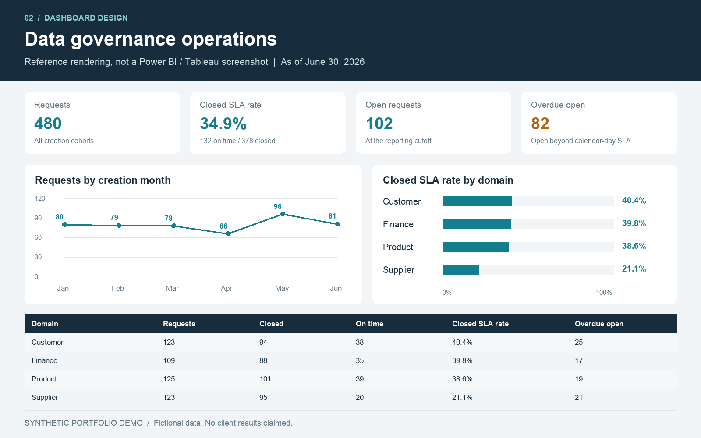

# Data governance operations dashboard
**Synthetic portfolio demo. Fictional requests and teams; no client work.**




A fictional data office needs to see incoming governance requests, closure SLA performance and overdue backlog. The sample connects governance concepts to operational reporting without inventing a data-quality score.

## Included
- `governance-dashboard.xlsx`: formula-driven Excel dashboard with domain selection and editable charts.
- `data/requests.csv`: 480 synthetic requests; `expected_metrics.json`: independent control totals.
- `powerbi/`: Power Query, DAX measures, theme and exact build/acceptance instructions.
- `tableau/`: calculated fields and build/acceptance instructions.
- `preview.png`: static reference visualization based on the dataset, **not a Power BI/Tableau screenshot**.
- `excel-preview.png`: rendered preview of the delivered Excel workbook.

## Reproduce source / check
```sh
python generate_data.py
python -m unittest discover -s tests -v
```
Python 3.10+, standard library only. These commands regenerate inputs and tests, not the XLSX. Excel opens the delivered workbook directly. To use new data, replace the existing 480 source rows in Excel and preserve columns/types; formulas are bounded through row 484 and must be extended for extra records. Exporting a new CSV alone does not refresh the workbook. Native Power BI and Tableau files are not included; assemble and test them with the supplied build guides.

## Metric contract
Grain = unique request. Reporting cutoff = June 30, 2026. Calendar days, not business days; close-date minus creation-date, same-day closure zero. SLA thresholds High=3, Medium=7, Low=14 days. A closed request at its threshold is on time. An open request is overdue only when its age exceeds its threshold. Closed SLA rate = on-time closed requests / closed requests, never average of group percentages. No-closed denominator is unavailable. Open backlog is the snapshot at the cutoff; overdue open uses the same population. Created-month trends count creation cohorts, not monthly closure throughput. There are no excluded requests, reopened requests or paused clocks in this simplified demo.

Source columns: ticket_id (text key), created_date/closed_date (ISO dates, null when open), domain, priority, owner_team, status (text dimensions), sla_days and age_or_cycle_days (whole calendar days), closed_flag/on_time_flag/overdue_flag (0/1 indicators). Closed flags are generated once; recompute them via the generator when changing demo logic. All source ownership/team labels are fictional.

## What can be claimed
An Excel dashboard and cross-platform dashboard implementation kit using a synthetic governance workflow. Do not claim completed Power BI/Tableau implementation, tested native interaction, client adoption or measured time savings until those steps actually happen. No PBIX, PBIT, TWB or TWBX is included. Excel was evaluated and rendered with the authoring engine; native Excel opening is a separate check.
