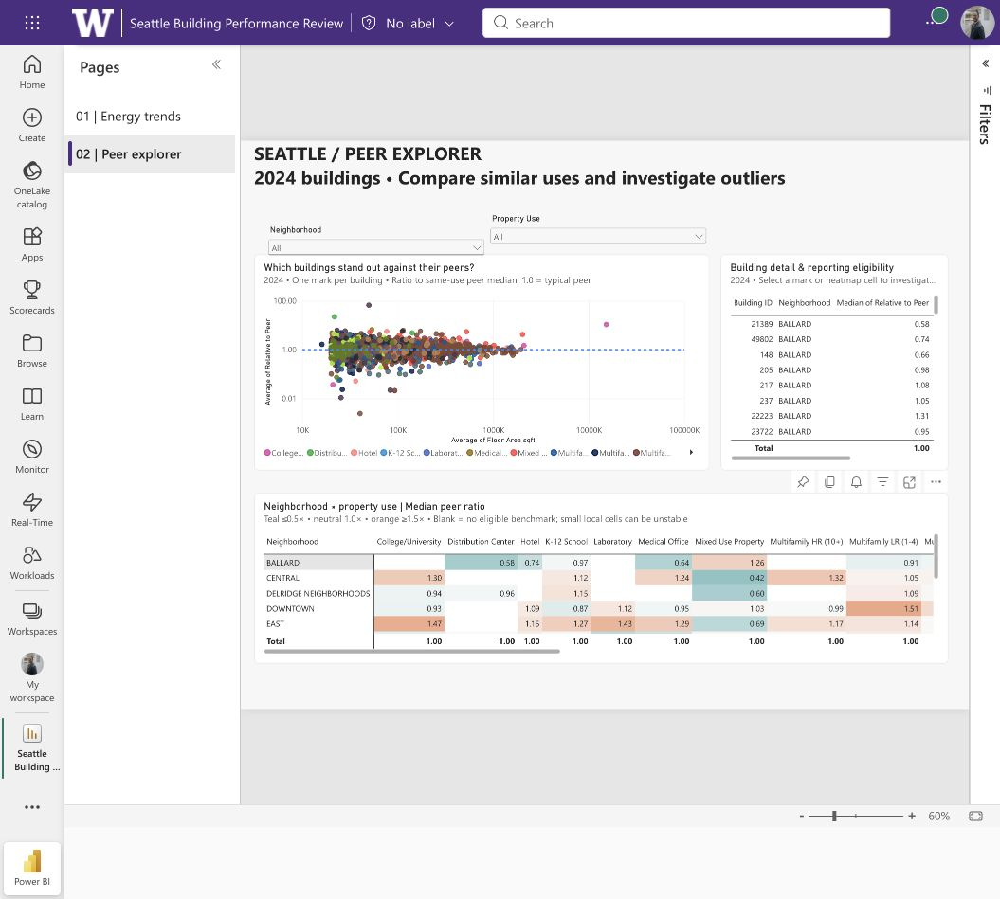
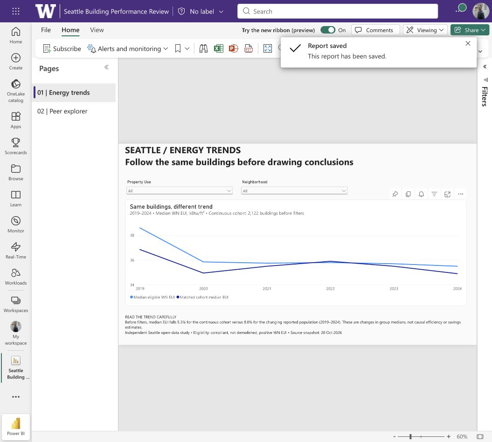

# Seattle Building Performance Review — Power BI

An editable native Power BI report exploring energy performance, reporting eligibility, and the difference between a changing reported population and a continuous building cohort.

## Open the report

Download **[Seattle Building Performance Review.pbix](Seattle%20Building%20Performance%20Review.pbix)** and open it in Power BI Desktop. The file was exported from Power BI Service with **report and data**, not as a live-only connection. No university account is needed to inspect the included file in Desktop. Refreshing the original web-upload source may require replacing its source with the included `Seattle Building Performance.csv` and signing in to any source you choose to use.

The hosted original remains in the author's university Power BI My workspace and requires authorized account access; it is not presented here as a public interactive link. GitHub previews are screenshots. GitHub does not run the PBIX as an interactive report.

## Explore

1. **Energy trends:** choose property use and neighborhood, then compare median eligible WN EUI with the continuous-cohort median over 2019–2024. Lines connect observed annual summaries with linear segments.
2. **Peer explorer:** fixed to 2024. Filter use/neighborhood, select a building scatter mark or heatmap cell, and inspect the linked building-detail table. Both scatter axes use logarithmic scaling. A ratio reference at 1.0 marks the frozen peer median. Power BI may sample marks in dense scatterplots; the visible scatter is not a guaranteed rendering of every record.
3. Heatmap colors saturate at 0.5× and 1.5×, centered on 1.0×. Blank values are not formatted as zero. Scroll the matrix and detail table or use focus mode for more room.

The four custom measures are in [measures.dax](measures.dax). Filters and cross-filtering were tested in the native Power BI Service. The exported PBIX archive was inspected for expected report pages and valid JSON; opening the exported file in Windows Desktop has not been tested on this Mac.

## Data and research design

Independent portfolio research using Seattle Open Data; **not paid client work and not affiliated with the City of Seattle**. The CSV contains 38,309 building-year records, 3,871 unique building IDs, and 28 fields, spanning 2015–2025. Source snapshot: 20 October 2026. The dashboards default to 2024 because finalization of 2025 reporting was not established.

[Seattle Building Energy Benchmarking source](https://data.seattle.gov/Built-Environment/Building-Energy-Benchmarking-Data-2015-Present/teqw-tu6e). Source data is public domain as described in DATA-LICENSE.txt. The source CSV SHA-256 is `83bdc829b7b6fd4f8ca5d058701382162063c8d634f7c93e4adaf1fe41659d6a`.

- **Eligible EUI:** compliant report, not demolished, nonmissing positive weather-normalized site energy-use intensity. No imputation or winsorization.
- **Peer benchmark:** median eligible WN EUI for the same reporting year and reported property use, with at least 20 eligible reports. These peer values are computed before neighborhood selections; selecting a neighborhood does not redefine the peer population.
- **Peer ratio:** building WN EUI divided by its peer median. 1.0 is the peer median. A high value is a research lead, not proof of inefficient operations. Property labels and source records may be imperfect.
- **Continuous cohort:** 2,122 buildings eligible in every year 2019–2024, with unchanged reported property use. At baseline, the cohort median changes from 36.85 to 34.90 kBtu/ft² (−5.3%). The changing eligible population median changes from 38.60 to 35.50 (−8.0%). These are changes in group medians, not causal savings estimates.
- **2024 coverage:** 3,712 reports; 3,425 eligible EUI records; 3,190 records with a sufficiently large peer group. The 287 EUI exclusions comprise 150 missing-EUI reports and 137 noncompliant reports, based on the eligibility-reason precedence in the analysis.
- Static insight banners describe the unfiltered baseline and explicitly say so. Chart values respond to selections. Sparse neighborhood/use cells can be unstable; inspect local sample counts.

The analysis pipeline is shared with the [Seattle energy platform](../seattle-energy-data-platform/). `analysis-validation.json` and `annual_coverage.csv` record the analysis checks and annual summaries. Original code and authoring history are retained in the local project archive; these dashboard folders provide the frozen prepared CSV and native deliverables. Code and workbooks were checked in the native applications.
