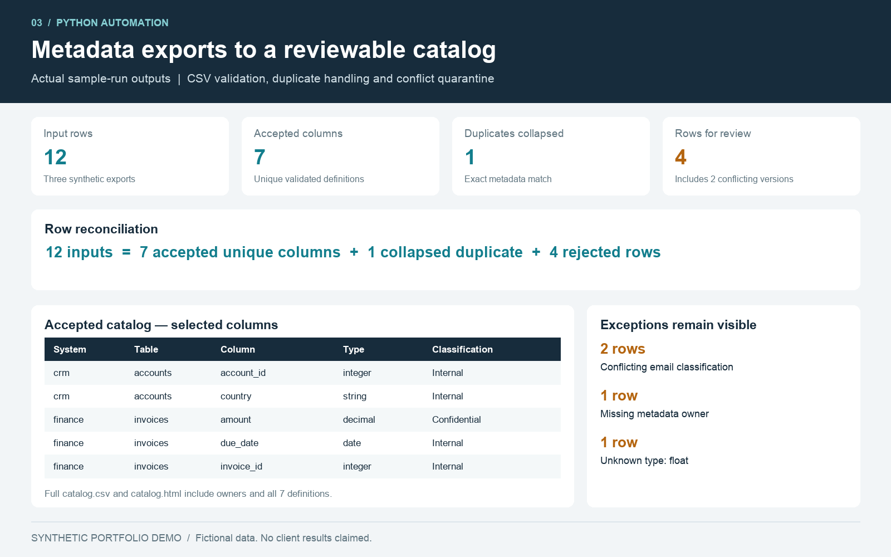

# Metadata export consolidation
**Synthetic portfolio demonstration. No real systems, accounts or client engagement.**




A fictional data office receives metadata exports from multiple systems. This command-line tool validates them, consolidates duplicate column definitions and quarantines conflicting records for human review.

## Run
Python 3.10+, no external packages. From this folder:
```sh
python consolidate.py --input sample-input --output example-output
python -m unittest discover -s tests -v
```
Outputs: accepted `catalog.csv`, row-level `exceptions.csv`, human-readable `catalog.html`, and `run-summary.json` with input SHA-256 hashes and row reconciliation. Input exports remain unchanged. Reruns produce identical contents when the inputs are unchanged; generated output names are replaced. Do not use an output folder containing files you want to keep under those names. Schema failures exit with code 2 before updating outputs. Row-level rejects are expected workflow results and exit successfully; inspect rejected_rows before any downstream use.

## Rules
Exact headers/order: system, table, column, data_type, owner, classification. Identifier fields allow letters, digits and underscore, beginning with a letter. Whitespace is trimmed; keys are case insensitive and output keys lowercased. Allowed types: string, integer, decimal, date, boolean. Allowed classification: Public, Internal, Confidential, Restricted. Owner requires a simple syntactically valid email, not verification of a mailbox. All sample addresses use reserved example.com.

Exact metadata duplicates collapse to one row. If valid rows for a key disagree on type, owner or classification, **all valid versions are quarantined**. Invalid rows are rejected before deduplication. Each exception includes its source file/line; accepted catalog rows can be traced to the input set using run-summary hashes and the normalized key. File-level schema/field-count failures stop the batch. CSV exception fields are escaped against spreadsheet formula interpretation and HTML output is escaped.

## Demo input
Three exports, including one repeated definition, a conflicting classification pair, one missing owner and one unknown type. See run-summary.json for actual resulting counts, not estimated time savings. This is a metadata preparation tool, not a live catalog integration, lineage scanner or automatic governance enforcement system.

## Reliability and limits
Tests exercise duplicate collapsing, conflicting definitions, invalid owners, schema failure preservation, deterministic reruns, non-nested output protection and CSV formula escaping. Output replacement is atomic per file, not a transaction across all four files. Concurrent runs are not supported; schedule only one writer. This small in-memory example needs streaming, a broader type map, access control and operational monitoring before production use. No mailbox or cloud connection is made.

## Portfolio caption
Created an Python automation demo that converts synthetic metadata exports into a validated catalog and exception queue. Added deterministic processing, source hashes and tests. Independent demonstration; no measured client time savings claimed.
