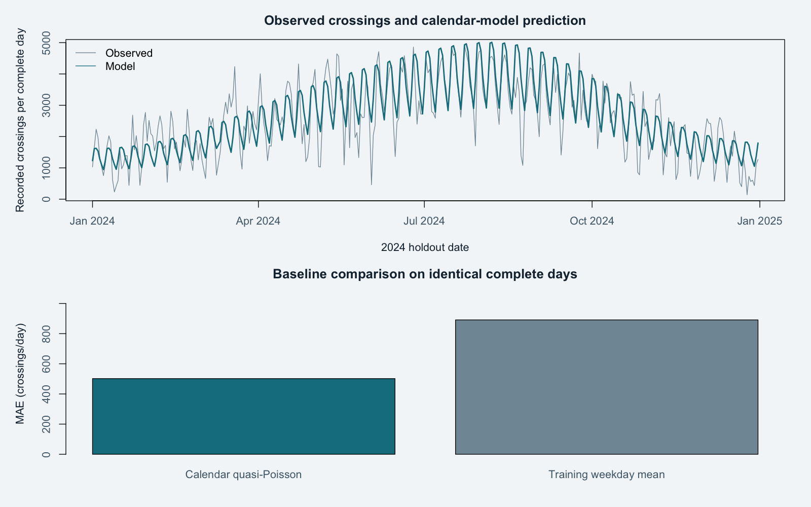

# Fremont Bridge mobility study in RStudio
> **GitHub edition:** generated SQLite databases are omitted from version control. Run this project’s documented build command first to create them locally. CSV/HTML/image example outputs and frozen inputs are included.


A coverage-aware daily data mart and interpretable calendar model using Seattle’s Fremont Bridge counter records. Demonstrates time-series preparation, SQL modelling, count regression, temporal validation and data governance.



## Start here

Open **results/report.html** for the completed analysis and **model/erd.svg** for the relational model. Open **FremontMobility.Rproj** in RStudio. The shipped results/daily.csv is already prepared; run `source("analysis.R")`, then `source("tests/test_analysis.R")` in the Console. To rebuild the full workflow from the frozen hourly source:

```sh
python3 run.py
python3 -m unittest discover -s tests -v
```

Alternatively run `python3 prepare.py`, then the two R scripts, then `python3 build_report.py`. The Python preparation step is necessary after refreshing the hourly source. No R package installation is needed.

## Data model and coverage

26,304 hourly records from 2022–2024 feed a complete 1,096-day calendar. Only days with 24 records, 24 valid totals and 24 unique hour labels receive daily counts. Four days are excluded, retained as nulls. Fourteen hourly records fail the nonmissing, nonnegative integer or sidewalk-total reconciliation checks. See exceptions.csv and daily.csv rather than assuming every exclusion is a daylight-saving issue. No hours are zero-filled or imputed. Source timestamps are floating local clock labels; timezone offsets are unavailable.

`model/schema.sql` enforces a station × calendar-date grain, station/date foreign keys, and coverage/null consistency. `results/mobility.sqlite` is a working physical model. Every date is represented, including incomplete days. Daily sidewalk totals are available in results/daily.csv; the central SQL fact stores combined crossings and coverage fields.

## Model and results

Quasi-Poisson log-link regression includes weekday, first and second annual harmonics, and a linear time trend. Train on 2022–2023 complete days and evaluate 2024. A separate development check fits only 2022 and predicts 2023. The baseline uses weekday averages estimated from the corresponding training population only. No 2024 actual counts enter predictor construction or fitted parameters.

On the same 365 complete days in 2024, model MAE is **501.69 crossings/day**, versus **890.95** for the weekday baseline (43.7% lower). The model is worse than baseline in the 2023 validation check. No claim of consistent future superiority is justified.

The counter detects crossings, not unique individuals. The catalogue now describes combined bicycle and scooter counts, while its CSV headers retain Cyclist wording. Keep source sidewalk labels; do not infer travel direction from these headers.

## Inspect and verify

Outputs include daily.csv, quality-report.json, exceptions.csv, mobility.sqlite, metrics.csv, predictions.csv, coefficients.csv, diagnostics.csv, split-audit.csv, mobility-model.rds, actual R session info and chart. Tests verify calendar coverage, missing-value policy, sidewalk reconciliation, relational constraints, chronological splits, matched scoring populations and independently recalculated MAE. MODEL-CARD.md documents use limits.

## Disclosure and provenance

Independent portfolio demonstration using **real City of Seattle public data**. This is not paid client work, a city commission, or evidence of production results. Code is MIT licensed; the source catalogue marks the data Public Domain. See DATA-LICENSE.txt and data/source-manifest.json for attribution, field projection, study window, original export row count, hashes and retrieval date (20 October 2026). The snapshots are frozen for reproducibility; source revisions may change later results.

No accounts, tokens, paid services or network access are required to reproduce the included snapshot. Paths are relative to the repository root. Run commands from that root. Python 3.10+ and, for the statistical projects, R 4.2+ are required. `requirements.txt` documents that there are no third-party Python dependencies. All R packages used ship with R.

## Refresh safely

Download **All data → CSV** from the linked official dataset page. Keep the old snapshot. Apply the field projection and year window recorded in the manifest, preserve source values as strings, then update original/included hashes and row counts. For R projects also update data/source.md5. Review schema changes, exclusions, identifier grain and metric changes before committing. Rerun every check. Do not silently replace data in a published case study while keeping its old findings.
