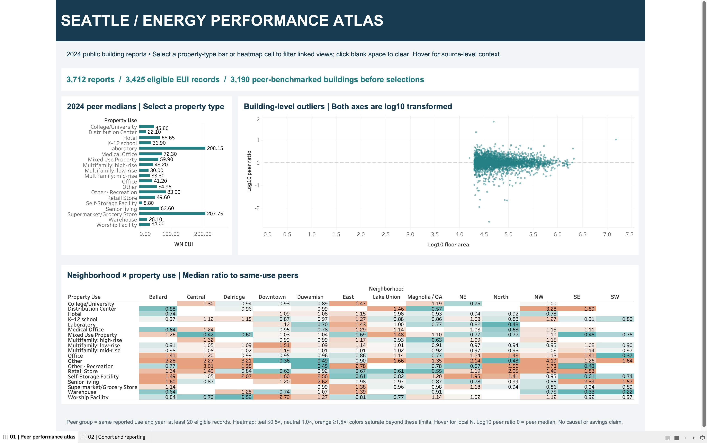
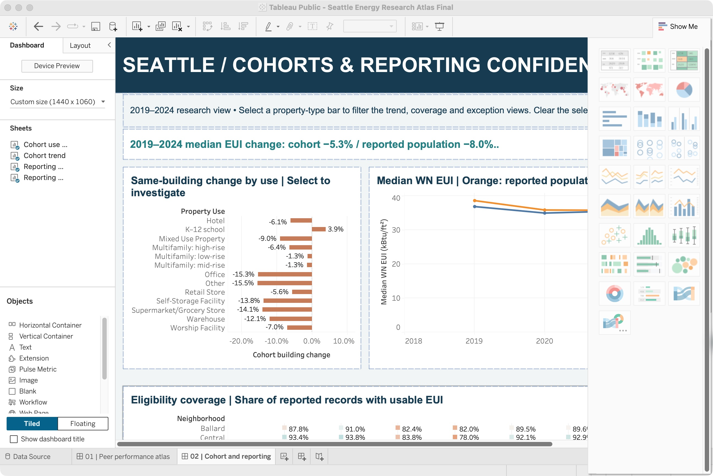
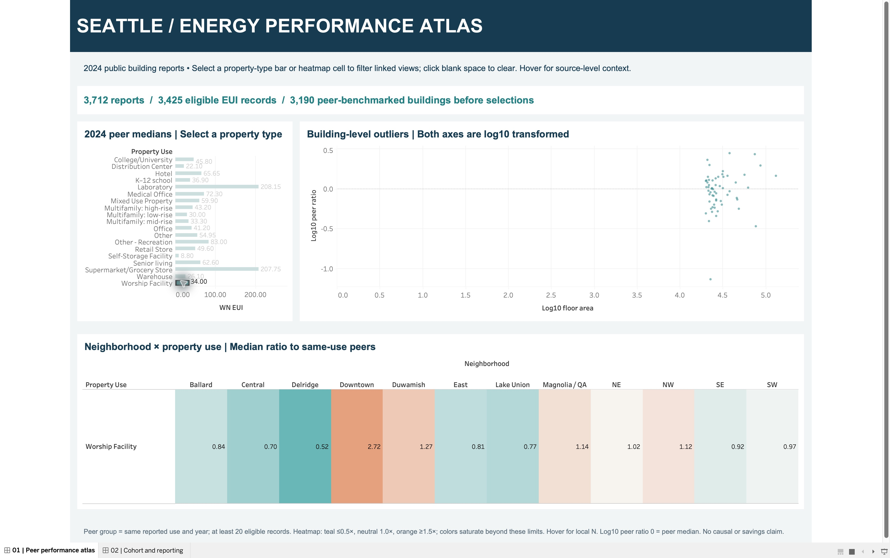

# Seattle Energy Research Atlas — Tableau

A native Tableau workbook with seven worksheets, two dashboards, embedded public data, and three tested selection actions.

## Open the workbook

Download **[Seattle Energy Research Atlas.twbx](Seattle%20Energy%20Research%20Atlas.twbx)** and open it in Tableau. The package includes the native workbook, CSV and Hyper extract. It was opened and checked in Tableau Public 2026.3. Compatibility with older releases is not guaranteed. A Tableau Public website publication has not been created for this dashboard; the interactive experience is available by opening the downloaded workbook. GitHub displays screenshots and source files.

The standalone `.twb` is readable XML for review and version comparison. For immediate use, open the `.twbx`; the standalone XML expects the bundled Data folder rather than only the adjacent CSV.

## Explore

1. **Peer performance atlas:** select a property-type bar to filter the scatterplot and neighborhood/use heatmap. Select a heatmap cell to filter the other charts. Clear the source selection to restore all records. Hover marks for building ID, raw measures and peer/local counts. The scatter uses log10-transformed area and peer ratio; a log10 ratio of 0 means a raw peer ratio of 1.0. Peer values remain frozen when a neighborhood is selected.
2. **Cohort and reporting:** compare orange reported-population medians with blue continuous-cohort medians. Select a property-type bar to filter trend, coverage and reporting exceptions. Coverage uses all reported records as the denominator. The bar chart shows the median of individual building percentage changes, which differs from the trend's percentage change in group medians. Bars require at least 20 paired buildings per use.
3. Use Tableau's presentation mode for the full dashboard layout. Hover for details; no field is silently treated as zero when missing.

Both pages rendered in native Tableau. Tested selections: Worship Facility bar filtered scatter and heatmap; Ballard/Office heatmap cell filtered bar and building scatter; Office cohort bar changed trend and coverage. The initial packaged file is generated without these test selections applied. The final revision also shortens the baseline banner and clarifies the exception-count axis label.

## Data and research design

Independent portfolio research using Seattle Open Data; **not paid client work and not affiliated with the City of Seattle**. The CSV contains 38,309 building-year records, 3,871 unique building IDs, and 28 fields, spanning 2015–2025. Source snapshot: 20 October 2026. The dashboards default to 2024 because finalization of 2025 reporting was not established.

[Seattle Building Energy Benchmarking source](https://data.seattle.gov/Built-Environment/Building-Energy-Benchmarking-Data-2015-Present/teqw-tu6e). Source data is public domain as described in DATA-LICENSE.txt. The source CSV SHA-256 is `83bdc829b7b6fd4f8ca5d058701382162063c8d634f7c93e4adaf1fe41659d6a`.

- **Eligible EUI:** compliant report, not demolished, nonmissing positive weather-normalized site energy-use intensity. No imputation or winsorization.
- **Peer benchmark:** median eligible WN EUI for the same reporting year and reported property use, with at least 20 eligible reports. These peer values are computed before neighborhood selections; selecting a neighborhood does not redefine the peer population.
- **Peer ratio:** building WN EUI divided by its peer median. 1.0 is the peer median. A high value is a research lead, not proof of inefficient operations. Property labels and source records may be imperfect.
- **Continuous cohort:** 2,122 buildings eligible in every year 2019–2024, with unchanged reported property use. At baseline, the cohort median changes from 36.85 to 34.90 kBtu/ft² (−5.3%). The changing eligible population median changes from 38.60 to 35.50 (−8.0%). These are changes in group medians, not causal savings estimates.
- **2024 coverage:** 3,712 reports; 3,425 eligible EUI records; 3,190 records with a sufficiently large peer group. The 287 EUI exclusions comprise 150 missing-EUI reports and 137 noncompliant reports, based on the eligibility-reason precedence in the analysis.
- Static insight banners describe the unfiltered baseline and explicitly say so. Chart values respond to selections. Sparse neighborhood/use cells can be unstable; inspect local sample counts.

The analysis pipeline is shared with the [Seattle energy platform](../seattle-energy-data-platform/). `analysis-validation.json` and `annual_coverage.csv` record the analysis checks and annual summaries. Original code and authoring history are retained in the local project archive; these dashboard folders provide the frozen prepared CSV and native deliverables. Code and workbook authoring used AI assistance, followed by native application checks.
